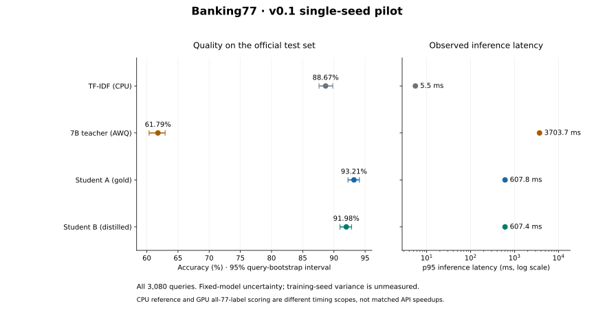
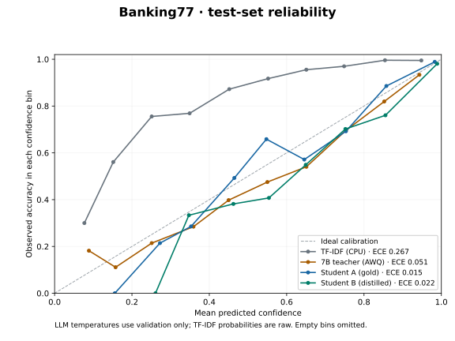
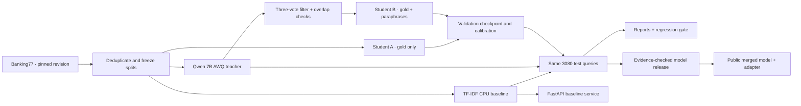

# Banking77 Distillation

[](https://github.com/jatinmallarapu/Banking77Distillation/actions/workflows/ci.yml)
[](LICENSE)
[](https://huggingface.co/JatinMallarapu/qwen2.5-0.5b-banking77-distill)

**When is prompting not enough?** Prompting, supervised fine-tuning and sequence-level
distillation compared for customer-intent routing, with a small model released on Hugging Face.

**v0.1: pilot, single seed, 200-query teacher subset.**
[Merged model](https://huggingface.co/JatinMallarapu/qwen2.5-0.5b-banking77-distill)
· [LoRA adapter](https://huggingface.co/JatinMallarapu/qwen2.5-0.5b-banking77-distill-lora)
· [Model card](MODEL_CARD.md)
· [Anonymous download and inference proof](release/public_verification.json)

## Measured results

All four systems were evaluated on the same **3,080 official test queries**. The
training split contains **8,992 gold queries**, with **1,000 validation queries**.
Student B adds **480 accepted paraphrases** from 200 intent-balanced training
sources: **480/600 retained (80%)**, requiring three teacher votes to agree with
the source label. The paraphrases are teacher-filtered, not human-verified.

| System | Accuracy [95% CI] | Macro-F1 [95% CI] | p50 / p95 ms |
| --- | --- | --- | ---: |
| [TF-IDF + logistic regression (CPU)](evals/results/tfidf-test.json) | 88.67% [87.61, 89.81] | 88.71% [87.62, 89.85] | 3.21 / 5.54 |
| [Qwen2.5-7B AWQ · zero-shot](evals/results/zeroshot-batch1.json) | 61.79% [60.37, 62.94] | 59.68% [58.06, 60.80] | 3684.31 / 3703.69 |
| [Student A · gold only, seed 1](evals/results/student_a-seed1-batch1.json) | 93.21% [92.26, 94.09] | 93.21% [92.23, 94.08] | 548.23 / 607.81 |
| [Student B · gold + distilled, seed 1](evals/results/student_b-seed1-batch1.json) | 91.98% [90.97, 92.82] | 91.95% [90.94, 92.79] | 548.55 / 607.44 |

**The negative result matters:** Student B scored **1.23 percentage points below
Student A** in this pilot. Distillation did not improve the measured student
accuracy. The released artifact is Student B's validation-selected checkpoint,
so that the augmentation experiment is inspectable and reproducible; it is not
presented as the strongest model in this comparison.

Intervals are 300 label-stratified query-bootstrap resamples of a fixed fitted
model. One seed cannot estimate training-seed variation. GPU timings measure
**all-77-label likelihood scoring**, including EOS, at batch 1. They are not
greedy-generation or HTTP serving benchmarks. TF-IDF timings are CPU references,
not matched GPU speedups. Resumed evaluations preserve measured batches and
session IDs. The GPU price assumption is **$0/hour on free compute**; zero recorded
cost is not a production hosting quote.

[Compressed per-query predictions and checksums](evals/results/prediction-files.json)
include all 3,080 case IDs, masked text, labels, confidence and measured latency
for each system. Download and decompress the adjacent `.jsonl.gz` files to audit
the reports; the recorded accuracy, macro-F1 and latency percentiles were checked
against these rows.





TF-IDF uses raw logistic probabilities; the LLMs use validation-selected
temperature scaling. Calibration comparisons therefore reflect that difference
as well as the models. [Figure source hashes](docs/figures/sources.json).

## What this project demonstrates

- A simple CPU baseline alongside a 7B teacher and two 0.5B LoRA students.
- Training-only distillation, immutable data/model revisions, overlap checks and
  frozen augmentation included with the public model artifacts.
- Full-test quality, uncertainty intervals, calibration, coverage curves, latency,
  token counts and explicit cost assumptions in machine-readable reports.
- A 300-case regression gate, API contract tests, bounded inputs and PII masking.
- Atomic evaluation checkpoints and checksum-verified private recovery, followed
  by an evidence gate and fresh-process anonymous model verification.

## Architecture



Teacher data generation uses a vLLM endpoint; the measured teacher evaluation
uses pinned local AWQ weights and complete-label likelihoods. These are separate
execution paths, not a vLLM serving-performance claim.

## Run the CPU baseline in three commands

Use Python 3.11 and an isolated environment. From the parent directory:

```sh
git clone https://github.com/jatinmallarapu/Banking77Distillation.git
python -m pip install -e "./Banking77Distillation[dev]"
make -C Banking77Distillation baseline gate
```

This prepares the pinned data, trains TF-IDF and checks the frozen 300-case gate.
To explicitly rerun the full official test evaluation, from the repository run
`b77 evaluate-baseline --split test --final-test`. Hardware-dependent timing will
differ. `make test` runs unit/integration tests and `make up` starts the baseline
FastAPI service with Docker Compose. `/classify` serves TF-IDF; the released Qwen
weights are separate artifacts, not silently substituted into that endpoint.

## Reproduce the GPU experiment

Install `.[train,teacher-eval]` on existing GPU compute and follow the
[release reproduction protocol](docs/REPRODUCE_RELEASE.md). The public model includes
`filtered_training_paraphrases.jsonl` and `release_evidence.json`, recording
dataset fingerprints, model revisions, training settings and the declared scope.
Use the frozen augmentation to reproduce training without regenerating stochastic
teacher outputs. See [evaluation recovery](docs/EVALUATION_RECOVERY.md) for score
checkpoints and identity checks. The broader original runners may also schedule
batch 32; the published v0.1 reports declare batch 1 only.

The [model card](MODEL_CARD.md) gives an anonymous usage example. Its generation
example is a load smoke test; the reported classification metrics require the
all-label scorer and the documented system prompt.

## Guardrails and failure analysis

The selected Student B was audited on **50 authored clean/attack pairs**:
**36.00%** changed its raw output,
**30.00%** returned the forced target, and
**0.00%** were flagged for review at the
validation-selected operating point. These small authored cases do not certify
resistance to arbitrary attacks. [Measured audit](evals/results/student_b-seed1-injections.json).

Both students selected a zero abstention threshold for the configured 90%
empirical validation target; that operating point performs no abstentions.
Coverage curves are retained for inspection. Regex masking is partial protection,
not a privacy guarantee. Never use this prototype for payments, fraud decisions
or unreviewed real-customer banking workflows.

[Read the pilot failure analysis](docs/STUDENT_PILOT_FINDINGS.md): close intent
boundaries, lower validation loss without better test accuracy, and the exact-case
taxonomy mismatch that initially stopped the injection audit.

## Limitations and next experiments

This is an English, in-domain benchmark with one training seed and a small
teacher-source subset. Few-shot comparison, additional seeds, full-source
distillation, batch-32 scaling, domain-shift tests and production serving load
tests remain future work. Teacher agreement does not establish paraphrase quality.
The original training manifests record hardware but not the runtime-selected
dtype; the model card preserves that limitation. The merged artifact uses float32.

## License and attribution

Personal research project, not affiliated with a bank, PolyAI or Qwen. Code: MIT.
Released weights: Apache 2.0, derived from Qwen2.5-0.5B-Instruct. Banking77 and
derived paraphrases: CC BY 4.0; credit PolyAI and Casanueva et al. (2020),
*Efficient Intent Detection with Dual Sentence Encoders*. See
[ATTRIBUTION.md](ATTRIBUTION.md) and the public model's license files.
