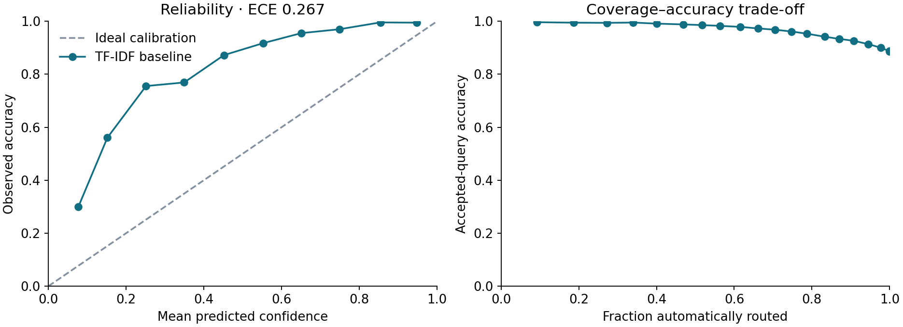
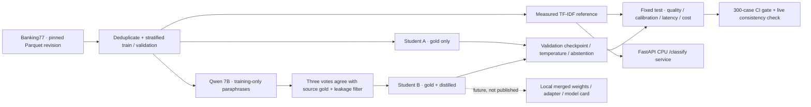

# Banking77 Distillation

[](https://github.com/jatinmallarapu/Banking77Distillation/actions/workflows/ci.yml)
[](LICENSE)
[](ATTRIBUTION.md)

**When is prompting not enough?** A reproducible experiment for comparing prompting,
fine-tuning and distillation in customer-intent routing—starting with a measured
CPU reference and recording GPU execution status explicitly.

## Results and execution status

The TF-IDF/logistic model was trained and evaluated on all **3,080 official test
queries**. **The public distilled model is not released yet.** The first release
now uses an intent-balanced **200-query teacher subset**, the full **8,992-query
gold training split**, and **one seed per student for v0.1**. The free Colab fallback
runs sequentially on one GPU. The original three-seed Kaggle study remains available;
additional seeds, batch-32 scaling, few-shot comparison and the larger all-source study remain future work
for the reduced v0.1 release. No GPU results below are implied by runner availability.

[Open the single-GPU Colab runner](https://colab.research.google.com/github/jatinmallarapu/Banking77Distillation/blob/main/notebooks/colab_single_gpu_pilot.ipynb)
· [Execution and recovery instructions](docs/COLAB_PILOT.md)

An earlier Kaggle session trained two gold-only seeds but stopped before a
verified external backup. Those checkpoints are not treated as current release
artifacts. The Colab retry uses verified private checkpoints and a foreground
runner. [Single-GPU execution and recovery](docs/COLAB_PILOT.md).

| System | Status | Test accuracy, 95% CI | Test macro-F1, 95% CI |
| --- | --- | --- | --- |
| TF-IDF + logistic regression | **Measured, CPU** | **88.67% [87.61, 89.81]** | **88.71% [87.62, 89.85]** |
| Zero-shot Qwen2.5-7B AWQ | Runner implemented; unrun | — | — |
| Retrieval few-shot Qwen2.5-7B AWQ | Runner implemented; unrun | — | — |
| Student A · gold only, seed 1 | **Measured, T4 GPU** | **93.21% [92.26, 94.09]** | **93.21% [92.23, 94.08]** |
| Student B · gold + pilot paraphrases, seed 1 | **Trained; adapter recovered. Test evaluation pending** | — | — |

**Current v0.1 training evidence:** the teacher retained **480/600 paraphrases (80%)**
from the balanced 200-source subset. Student A trained on 8,992 gold rows; Student B
trained on 9,472 rows including the accepted paraphrases. Their best validation losses
were **0.0559085980** and **0.0533467755**, respectively. Validation loss is not test
accuracy and does not establish that distillation improved routing quality.

Both adapters were recovered from a checksum-verified private backup after Colab
disconnected. Evaluation resumed on a free Kaggle T4 pair. Student A now has a
complete 3,080-query GPU report; Student B and the teacher are still evaluating.
Student A batch-1 latency is **548.23 ms p50 / 607.81 ms p95** for scoring all 77 labels;
this is a GPU inference measurement, not a production API benchmark.
[Measured Student A report](evals/results/student_a-seed1-batch1.json).
Public release and anonymous inference verification remain pending. [Recovered training evidence](evals/results/training-pilot-v01.json).

**Historical teacher-data pilot (interrupted run):** retained **478/600 paraphrases (79.67%)** from 200 training
queries covering all 77 intents, in **21.79 minutes** on one T4. Three seeded votes
still had to agree with the source gold label. This is augmentation retention,
not test accuracy or human-verified semantic quality. These are historical audit results, not the new release's training artifacts. [Pilot evidence](evals/results/teacher-pilot200.json).

The intervals use 300 label-stratified bootstrap resamples of a fixed model; they
are not training-seed standard deviations. [Full measured report](evals/results/tfidf-test.json)
contains worst-class intervals, calibration, coverage and the ten most confused
intent pairs. [Per-query predictions](evals/results/tfidf-test.jsonl) retain stable
case IDs, masked query text, prediction, confidence and measured latency.

| CPU behavior | Observed result |
| --- | ---: |
| Single-query model latency p50 / p95 | 8.32 / 12.15 ms |
| ECE, ten bins | 0.2668 |
| Coverage at validation-chosen threshold | 97.79% of test queries |
| Accuracy among automatically routed test queries | 90.01% |
| Authored injection pairs changing the raw label | 1 / 50 (2.0%) |
| Authored injection pairs hitting the forced target | 0 / 50 |

CPU batch-1 throughput was 109 queries/s; batching 32 queries reached 3,183
queries/s in the local model loop. These are **CPU measurements**, not GPU
comparisons. Provider API cost is zero for this baseline, excluding compute and
infrastructure. Neural GPU cost and latency are unmeasured.



**Current decision:** TF-IDF is a credible starting point for this narrow,
in-domain English task if its measured quality and human-review workload meet the
business target. It needs no GPU or language-model endpoint. Its confidence is
noticeably undercalibrated, and close intents still confuse it. There is currently
no evidence that a student matches the teacher or improves cost/quality; that
decision must wait for the predeclared GPU runs.

## Architecture



## Reproduce the CPU project in three commands

From a clone of this repository, with Python **3.11** and an isolated environment:

```sh
python -m pip install -e '.[dev]'
python scripts/reproduce_cpu.py
uvicorn b77.serve:app --host 127.0.0.1 --port 8000 --no-access-log
```

The reproduction command downloads the pinned public corpus, rebuilds the CPU
model, scores the frozen gate, checks its regression threshold and runs tests.
It does **not** rerun the full test set or start GPU work. Open `/docs` for the
interactive API schema. Docker alternative: `docker compose up --build`.

```sh
curl -X POST http://localhost:8000/classify -H 'Content-Type: application/json' \
  -d '{"text":"Where is my new debit card?"}'
```

The response is `{label, confidence, needs_human_review, latency_ms}`. Below the
validation-selected threshold, `label` is `needs_human_review`; otherwise it is
one of the 77 allowed labels. `/health` identifies the deployed **TF-IDF** system.
The API is a local research demo, with no authentication, banking actions or
production authorization controls. Do not expose it or submit real customer data.

## Data discipline

The official dataset contains 10,003 train and 3,080 test queries. Eleven duplicate
or overlapping training records are quarantined, leaving **8,992 train / 1,000
validation** queries. Test membership and labels are unchanged. The 300-case gate
is stratified with three or four examples per intent. IDs, source revision and
split hashes are versioned in [the manifest](data/manifest.json).

The teacher can paraphrase **training queries only**. A candidate is retained only
when three temperature-0.7 labels agree with the source gold label. The data records
text, label, source ID, votes, teacher agreement and revision. Normalized duplicate
and test/validation overlap checks fail closed. Agreement is not proof of semantic
correctness; manually inspect the retained examples. Keep rate: **unmeasured**.

CI's repeated gate is an exposed regression fixture, not a validation set for
hyperparameter selection. Future research comparisons should separately report
the 2,780 test queries outside that gate. See [the full protocol](docs/PROTOCOL.md).

## The prepared GPU experiment

The local GPU has 2 GB VRAM, so the six LoRA runs and 7B teacher were not attempted.
The staged runner targets an **existing** free Linux CUDA session with at least
14 GiB VRAM. It never rents hardware or uploads to Hugging Face.

```sh
python -m pip install -e '.[train,teacher,dev]'
python scripts/gpu_runner.py smoke
```

Then follow [GPU_RUNBOOK.md](docs/GPU_RUNBOOK.md) for teacher filtering, full
students, matched batch-1/batch-32 evaluation and local release preparation.
[The notebook](notebooks/free_gpu_runner.ipynb) is only a launcher; source code owns
the logic. The pinned training stack passed the actual T4 GPU smoke run. A two-step smoke checkpoint cannot pass the release readiness check.

- Student base: Qwen2.5-0.5B-Instruct, pinned revision, Apache 2.0.
- Teacher: Qwen2.5-7B-Instruct-AWQ, pinned revision, Apache 2.0.
- Three seeds each: 1, 2, 3. LoRA r=16, alpha=32, dropout=0.05, all linear layers.
- Completion-only SFT, three epochs, 2e-4 learning rate; best validation-loss checkpoint.
- Maximum training length 128, with explicitly counted query-tail truncation that
  retains the full label. BF16 where supported, FP16 otherwise.
- Teacher few-shot context uses ten nearest **training-only sparse TF-IDF vectors**;
  this is lexical retrieval, not a claimed dense-embedding system.
- Neural evaluation scores all 77 complete labels by sequence log-likelihood;
  validation chooses temperature and abstention. This decoder is more expensive
  than one guided generation, and that difference must be included in comparisons.

## Guardrails, CI and short load tests

Regex masking removes email-like strings and long numeric identifiers before
model input and prediction logging. The test suite covers mask idempotence,
input bounds, label vocabulary, actual API contracts, source/test leakage,
teacher request structure, calibration edge cases and incomplete-release rejection.
Regex masking is not a complete PII detector. A finite vocabulary prevents invented
labels, not wrong allowed labels or injection success.

The 50 authored injection pairs cross five clean prompts with ten override
wrappers. Their measured paired-change rate is a narrow regression result, not a
claim of comprehensive security. [Attack pairs](evals/injection_set.jsonl) ·
[Measured outcomes](evals/results/tfidf-injections.json)

Every PR rebuilds the baseline and scores the gate. CI blocks a macro-F1 decline
greater than **one absolute percentage point** from `evals/baseline.json`, missing
or duplicate cases, changed identities and live prediction/cache disagreement.
Container health and classification are also exercised. GPU experiments and Hub
uploads never run in CI. Baseline changes must be reviewed separately.

| Local HTTP smoke scenario | Requests in CSV snapshot | Failures | Requests/s | p50 / p95 |
| --- | ---: | ---: | ---: | ---: |
| 10 users | 111 | 0 | 17.1 | 17 / 200 ms |
| 50 users | 483 | 0 | 71.2 | 34 / 400 ms |
| 100 users | 902 | 0 | 112.2 | 110 / 340 ms |

These are short ten-second, loopback tests with think time, a ramp and shared
client/server CPU—not sustained capacity benchmarks. [Raw CSV and configuration](benchmarks/results.json).
The Locust file adapts the request pattern from LanguageModelInferenceBenchmark.

## Model release status

**No Hugging Face model has been published.** The planned name is
`JatinMallarapu/qwen2.5-0.5b-banking77-distill`, with a separate adapter and filtered
dataset after complete training and evaluation. No working model link is
implied. [MODEL_CARD.md](MODEL_CARD.md) is explicitly a preparation card.
`python -m b77.release` refuses missing or smoke-only runs; `--merge` is a local
operation after readiness checks. The gated publisher and anonymous verification
commands are documented in [PUBLICATION.md](docs/PUBLICATION.md); they do not make
the model released until the actual upload and verification pass.

## Files worth reviewing

| Path | Responsibility |
| --- | --- |
| `src/b77/data.py` | Pinned source, deduplication, splits and frozen gate |
| `baselines.py`, `metrics.py`, `gate.py` | Fitted baseline, uncertainty and regression checks |
| `teacher.py`, `train_student.py`, `scoring.py` | Filtering, LoRA and constrained likelihood evaluation |
| `guardrails.py`, `serve.py` | Masking, bounded schemas and serving |
| `release.py`, `publish.py`, `verify_public.py` | Evidence gates, merge, public upload and anonymous verification |
| `evals/results/` | Measured, redacted CPU evidence |

## Attribution and limitations

Banking77 is by PolyAI, **CC BY 4.0**. Cite Casanueva et al. (2020), *Efficient Intent
Detection with Dual Sentence Encoders*. The gate subset and future adaptations
retain attribution; see [ATTRIBUTION.md](ATTRIBUTION.md). Project code is MIT;
Qwen's base weights are Apache 2.0 and are not included in this GitHub repository.

This is an independent portfolio project, not an Artefact, PolyAI, Qwen or bank
deployment. It does not cover forecasting, optimization, multilingual routing or
real banking decision quality. The unrun teacher/student comparison and unpublished
weights are material limitations, not completed achievements.
